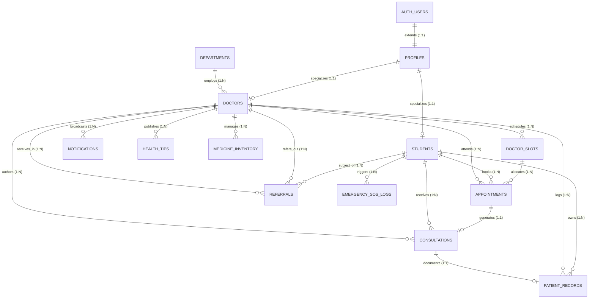

# 🏥 DTU Health Center – Supabase Database Architecture & Security Guide

This directory contains the production-grade PostgreSQL database architecture and Row Level Security (RLS) policies for the **DTU Health Center Management System**, engineered specifically for **Supabase**.

---

## 📌 Table of Contents
1. [Architectural Overview](#1-architectural-overview)
2. [No-Admin-Panel Philosophy (Supabase Dashboard Governance)](#2-no-admin-panel-philosophy-supabase-dashboard-governance)
3. [Entity Relationship Diagram (ERD)](#3-entity-relationship-diagram-erd)
4. [Table Catalogue & Field Mapping](#4-table-catalogue--field-mapping)
5. [Authentication Architecture & RBAC](#5-authentication-architecture--rbac)
6. [Row Level Security (RLS) Policy Matrix](#6-row-level-security-rls-policy-matrix)
7. [Automated Triggers & Capacity Management](#7-automated-triggers--capacity-management)
8. [SQL Scripts & Execution Sequence](#8-sql-scripts--execution-sequence)
9. [Required Supabase Dashboard Configurations](#9-required-supabase-dashboard-configurations)
10. [Security Remediation & Critical Audit Details](#10-security-remediation--critical-audit-details)
11. [Remaining Operational Risks & Manual Dashboard Tasks](#11-remaining-operational-risks--manual-dashboard-tasks)
12. [SQL Test Cases (Verification Suites)](#12-sql-test-cases-verification-suites)
13. [Concurrency Test Scenarios for Appointment Booking](#13-concurrency-test-scenarios-for-appointment-booking)

---

## 1. Architectural Overview

The DTU Health Center backend is architected around a **Decoupled 3-Tier Serverless Model**:
- **Presentation Layer (Frontend):** Modern, responsive HTML5, CSS3 Glassmorphism UI, and Vanilla JavaScript serving two discrete portal views:
  1. **Student Dashboard:** Slot booking, teleconsultation room, digital prescriptions, personal health profile, wellness advisories, and emergency ambulance SOS.
  2. **Doctor Dashboard:** Outpatient appointment queue, slot capacity posting, clinical prescription writer, inter-department referrals, pharmacy stock monitoring, and campus announcements.
- **Identity & Authentication Layer:** Supabase Auth (`auth.users`) enforcing JSON Web Token (JWT) sessions, email verification, and cryptographic password hashing (bcrypt).
- **Data & Security Layer:** Managed PostgreSQL 15+ in Supabase with strict Row Level Security (RLS) policies, foreign key cascades, and trigger-based data integrity guards.

---

## 2. No-Admin-Panel Philosophy (Supabase Dashboard Governance)

> [!IMPORTANT]
> By system design, **there is NO custom Admin UI, Admin Login page, or public Admin registration**. 
> All hospital governance, credential oversight, doctor onboarding, role assignments, and clinical audit tasks are performed directly by the project owner through the official **Supabase Dashboard** (`https://app.supabase.com`).

### Administrator Responsibilities Managed via Supabase Dashboard:
1. **User Role Management:** Promote authenticated accounts to `doctor` or `admin` status via the Table Editor (`public.profiles`).
2. **Doctor Staff Provisioning:** Register licensed medical practitioners into `public.doctors` and map them to clinical divisions.
3. **Clinical Record Oversight:** Audit consultations, appointments, and student medical histories (`public.patient_records`).
4. **Referral Monitoring:** Track critical or semi-urgent patient transfers across specialty departments.
5. **Dispensary Stock Replenishment:** Review low-inventory alerts and update pharmacy quantities (`public.medicine_inventory`).
6. **Emergency Review:** Monitor ambulance dispatch logs and campus accident hot-spots (`public.emergency_sos_logs`).

---

## 3. Entity Relationship Diagram (ERD)



---

## 4. Table Catalogue & Field Mapping

All 14 tables directly mirror the fields, state objects, and workflows inspected across the DTU Health Center frontend:

| Table Name | Primary Purpose | Key Fields | Primary Key | Foreign Keys |
|---|---|---|---|---|
| `public.profiles` | Unified user identity extending Supabase `auth.users` | `email`, `role`, `full_name`, `phone`, `avatar_url` | `id` (UUID) | `auth.users(id)` |
| `public.departments` | Hospital specialty divisions | `name`, `icon`, `description` | `id` (BIGINT) | — |
| `public.doctors` | Medical practitioner profiles & clinical credentials | `department_name`, `qualification`, `experience`, `photo`, `is_available` | `id` (UUID) | `profiles(id)`, `departments(id)` |
| `public.students` | DTU academic student healthcare records | `roll_no`, `branch`, `year_of_study`, `blood_group`, `phone`, `dtu_email` | `id` (UUID) | `profiles(id)` |
| `public.doctor_slots` | Doctor OPD weekly time windows with student caps | `date`, `start_time`, `end_time`, `max_limit`, `booked_count`, `note`, `is_active` | `id` (BIGINT) | `doctors(id)` |
| `public.appointments` | Patient consultation bookings & queue encounters | `date`, `time_window`, `mode`, `reason`, `urgency`, `status` | `id` (TEXT) | `students(id)`, `doctors(id)`, `doctor_slots(id)` |
| `public.consultations` | Digital prescriptions, medicines dosage, test orders | `diagnosis`, `medicines` (JSONB), `tests`, `follow_up_date`, `notes` | `id` (TEXT) | `students(id)`, `doctors(id)`, `appointments(id)` |
| `public.patient_records` | Longitudinal student medical timeline & health encounters | `record_type`, `title`, `description`, `attachments` (JSONB), `recorded_at` | `id` (UUID) | `students(id)`, `doctors(id)`, `consultations(id)` |
| `public.referrals` | Inter-department specialist referral slips | `from_dept`, `to_dept`, `priority`, `reason`, `tests`, `status` | `id` (TEXT) | `students(id)`, `from_doctor_id`, `to_doctor_id` |
| `public.notifications` | Campus doctor health advisories & vaccination drives | `title`, `content`, `type`, `author_name`, `department`, `is_active` | `id` (BIGINT) | `doctors(id)` |
| `public.emergency_sos_logs`| Real-time ambulance requests with campus geolocation | `campus_location`, `emergency_type`, `status`, `dispatched_at` | `id` (UUID) | `students(id)` |
| `public.medicine_inventory`| Health center dispensary stock and low-inventory alerts| `name`, `category`, `stock`, `unit`, `expiry`, `min_threshold` | `id` (BIGINT) | `doctors(id)` |
| `public.health_tips` | Preventative wellness articles for student wellness | `title`, `content`, `author`, `category` | `id` (BIGINT) | `doctors(id)` |
| `public.emergency_contacts`| 24/7 emergency telephone numbers & hospital locations | `name`, `phone`, `available`, `location` | `id` (BIGINT) | — |

---

## 5. Authentication Architecture & RBAC

1. **User Identity Provider:** Supabase Auth (`auth.users`) is the authoritative identity provider. Plain-text passwords are never stored; Supabase applies industry-standard `bcrypt` password hashing.
2. **Automatic Profile Provisioning:** The database hook `public.handle_new_user()` listens to `AFTER INSERT ON auth.users`. When a user completes public signup, it automatically generates a linked record in `public.profiles`.
3. **Role Segregation:**
   - **`student`**: Default role assigned to all public registrations.
   - **`doctor`**: Assigned exclusively through the Supabase Dashboard by the system owner or via `public.admin_assign_doctor_role()`.
   - **`admin`**: Assigned exclusively via the Supabase Dashboard.
4. **Privilege Escalation Prevention:**
   The trigger `trg_prevent_role_escalation` on `public.profiles` aborts any client-initiated update where `OLD.role != NEW.role`. A student cannot elevate their own role to doctor or admin, even by tampering with Supabase client-side API requests.

---

## 6. Row Level Security (RLS) Policy Matrix

Row Level Security is enabled on **all 14 tables**. The following matrix outlines operational permissions incorporating our strict healthcare privacy and clinical relationship enforcement:

| Table | Operation | `student` Access | `doctor` Access | `admin` (Dashboard) Access | Policy Enforcement Mechanism |
|---|---|---|---|---|---|
| `profiles` | SELECT | Own profile + all Doctor profiles | All profiles | All profiles | `profiles_select_policy` |
| `profiles` | UPDATE | Own profile non-privileged fields | Own profile | All profiles | Prevent escalation trigger + RLS |
| `departments` | SELECT | Public read (`anon, authenticated`) | Public read (`anon, authenticated`) | Full control | Public catalog read policy |
| `departments` | ALL | Disallowed | Disallowed | Full control | `departments_admin_all_policy` |
| `doctors` | SELECT | Public read (`anon, authenticated`) | Public read (`anon, authenticated`) | Full control | Public clinical directory policy |
| `doctors` | UPDATE | Disallowed | Own profile / availability | All doctors | `doctors_update_own_policy` |
| `students` | SELECT | Own profile only | Only patients with clinical relationship | All student records | `students_select_policy` (`doctor_has_clinical_relationship`) |
| `students` | INSERT/UPDATE| Own record only | Disallowed | Full control | `students_insert_own_policy` / `update_own_policy` |
| `doctor_slots` | SELECT | Active slots (`anon, authenticated`) | Active slots + own past slots | All slots | `doctor_slots_select_policy` |
| `doctor_slots` | INSERT/UPDATE/DELETE| Disallowed | Own slots (`doctor_id = auth.uid()`)| Full control | `doctor_slots_insert_policy` |
| `appointments` | SELECT | Own appointments (`student_id = auth.uid()`)| Assigned appointments (`doctor_id = auth.uid()`)| All appointments | `appointments_select_policy` |
| `appointments` | INSERT | Yes (for self) | Disallowed | Full control | `appointments_insert_policy` |
| `appointments` | UPDATE | Cancel confirmed booking only | Update status to `completed` or `cancelled` | Full control | Dual-layer: `appointments_student_cancel_policy` + `validate_appointment_update` trigger |
| `appointments` | DELETE | Disallowed | Disallowed | Full control | `appointments_admin_delete_policy` |
| `consultations`| SELECT | Own prescriptions only | Prescriptions for patients under care | All prescriptions | `consultations_select_policy` (`doctor_has_clinical_relationship`) |
| `consultations`| INSERT | Disallowed | Authored for treated patient (`doctor_id = auth.uid()`) | Full control | `consultations_insert_policy` |
| `consultations`| UPDATE | Disallowed | Authoring doctor only | Full control | `consultations_update_policy` |
| `patient_records`| SELECT | Own medical history | Only patients with clinical relationship | All records | `patient_records_select_policy` (`doctor_has_clinical_relationship`) |
| `patient_records`| INSERT | Disallowed | Authoring doctor with clinical relationship | Full control | `patient_records_insert_policy` |
| `patient_records`| UPDATE | Disallowed | Authoring doctor only | Full control | `patient_records_update_policy` |
| `referrals` | SELECT | Own referrals | From-doctor or To-doctor | All referrals | `referrals_select_policy` |
| `referrals` | INSERT | Disallowed | Referring doctor with active clinical relationship | Full control | `referrals_insert_policy` |
| `referrals` | UPDATE | Disallowed | Referring or receiving doctor | Full control | `referrals_update_policy` |
| `notifications`| SELECT | All active bulletins | All active bulletins | All bulletins | `notifications_select_policy` |
| `notifications`| INSERT/UPDATE| Disallowed | Yes (must bind `doctor_id = auth.uid()`) | Full control | `notifications_insert_policy` / `update_policy` |
| `emergency_sos_logs`| INSERT | Yes (`anon, authenticated` with regex check) | Yes | Full control | `emergency_sos_insert_policy` + 60s cooldown trigger |
| `emergency_sos_logs`| SELECT/UPDATE| Own requests only | All alerts (dispatch/resolve) | Full control | `emergency_sos_update_policy` |
| `medicine_inventory`| SELECT | View available medicines| View inventory | Full control | Public authenticated read |
| `medicine_inventory`| INSERT/UPDATE| Disallowed | Update stock counts & batches | Full control | `medicine_inventory_update_policy` |
| `health_tips` | SELECT | Public read (`anon, authenticated`)| Public read (`anon, authenticated`)| Full control | Public wellness article policy |
| `health_tips` | INSERT/UPDATE| Disallowed | Publish wellness advice (`doctor_id = auth.uid()`) | Full control | `health_tips_insert_policy` / `update_policy` |
| `emergency_contacts`| SELECT | Public read (`anon, authenticated`)| Public read (`anon, authenticated`)| Full control | Public emergency directory policy |

---

## 7. Automated Triggers & Capacity Management

1. **`trg_sync_slot_capacity_insert_update` and `trg_sync_slot_capacity_delete` on `public.appointments`:**
   - **Row-Level Locking:** Uses `SELECT ... FOR UPDATE` on `public.doctor_slots` inside `BEFORE INSERT OR UPDATE` to serialize concurrent booking transactions, eliminating overscheduling race conditions.
   - **Strict Capacity Rejection:** If `booked_count >= max_limit` or the slot is deactivated (`is_active = false`), the trigger raises an immediate exception, rejecting the appointment before any row is committed.
   - **Slot Reassignment Handling:** If an appointment's `slot_id` is moved from Slot A to Slot B, Slot A is decremented and Slot B is checked for capacity and atomically incremented.
   - **Cancellation & Deletion:** On status transition to `'cancelled'` or on hard appointment deletion (`AFTER DELETE`), `booked_count` is decremented (guarded by `GREATEST(0, booked_count - 1)`), immediately freeing capacity for other students.

2. **`validate_appointment_update` on `public.appointments` (Dual-Layer Defense):**
   - Enforces that student clients can **only** transition confirmed appointments to `'cancelled'`.
   - Prevents student clients from tampering with `doctor_id`, `student_id`, `slot_id`, `date`, `time_window`, `mode`, or marking appointments `'completed'`.
   - Restricts doctors to only updating appointments assigned to them (`OLD.doctor_id = auth.uid()`) and limits status transitions to `'completed'` or `'cancelled'`.
   - Protects immutable primary keys and user ownership references.

3. **`validate_emergency_sos_submission` on `public.emergency_sos_logs`:**
   - Enforces valid contact phone format (`^\+?[0-9]{10,15}$`) and minimum 3-character location descriptions.
   - Enforces an automated 60-second database-level cooldown per contact number to mitigate duplicate and rapid-fire spam submissions.

4. **`doctor_has_clinical_relationship` Security Definer Helper:**
   - Evaluates whether a doctor has a legitimate clinical relationship with a patient:
     1. Scheduled, attending, or past appointment in `public.appointments`.
     2. Outgoing or incoming referral in `public.referrals`.
     3. Authored digital prescription/consultation in `public.consultations`.
     4. Logged medical record encounter in `public.patient_records`.
   - Restricts general doctor queries across `public.students`, `public.patient_records`, and `public.consultations` to protect student privacy according to clinical privacy standards.

5. **`trg_prevent_role_escalation` on `public.profiles`:**
   - Blocks any authenticated user from changing their own `role` field via the client API.

6. **`handle_updated_at` on all mutable tables:**
   - Automatically maintains UTC ISO timestamps upon every `UPDATE` query.

---

## 8. SQL Scripts & Execution Sequence

All SQL scripts are located in this directory (`supabase/database/`). When setting up a new Supabase project, execute the scripts sequentially in the **Supabase SQL Editor**:

```
supabase/database/
├── 01_schema.sql                  (Step 1: Extensions, Enums & Custom Types)
├── 02_tables.sql                  (Step 2: Table Structures & Column Constraints)
├── 03_relationships_indexes.sql   (Step 3: Foreign Key Relationships & Indexes)
├── 04_functions_triggers.sql      (Step 4: Auth Hooks, Capacity Triggers & Functions)
├── 05_rls_policies.sql            (Step 5: Row Level Security Policies)
└── 06_seed_data.sql               (Step 6: Departments, Medicines, Directory & Seed)
```

### Execution Procedure:
1. Log in to [Supabase Dashboard](https://app.supabase.com).
2. Select your project and navigate to the **SQL Editor** tab from the left sidebar.
3. Open and run each script one by one in numerical order (`01` through `06`).
4. Ensure each query outputs `Success. No rows returned` before advancing to the next file.

---

## 9. Required Supabase Dashboard Configurations

To complete backend setup, configure the following settings in your Supabase project dashboard:

1. **Authentication Providers (`Authentication -> Providers -> Email`):**
   - **Enable Email Provider:** Set to `ON`.
   - **Confirm Email:** Recommended `ON` for production; can be toggled `OFF` during development testing.
   - **Secure Email Change:** Enabled.
2. **URL Configuration (`Authentication -> URL Configuration`):**
   - **Site URL:** Set to your production URL (e.g., `https://hiteshmeena052005-wq.github.io/DTU-HEALTH-CENTER-/` or `http://localhost:5500` for local dev).
   - **Redirect URLs:** Add:
     - `https://hiteshmeena052005-wq.github.io/DTU-HEALTH-CENTER-/**`
     - `http://localhost:5500/**`
     - `http://127.0.0.1:5500/**`
3. **Database Realtime (`Database -> Publications`):**
   - Verify that tables needing cross-client instant refresh (`appointments`, `doctor_slots`, `notifications`, `emergency_sos_logs`) are included in the `supabase_realtime` publication for real-time WebSocket broadcasting.

---

## 10. Security Remediation & Critical Audit Details

This database architecture includes targeted remediations addressing specific security vulnerabilities:

### 1. Admin Provisioning via Supabase SQL Editor & RPC Hardening
- **Vulnerability:** Supabase SQL Editor runs as the `postgres` database user where `auth.role()` and `auth.uid()` evaluate to `NULL`. The previous internal check failed with `Access Denied` when executed by the owner in the SQL Editor. Furthermore, Supabase defaults function execution to `PUBLIC`.
- **Remediation:** 
  - Granted execute strictly to `postgres` superuser and `service_role`; executed explicit `REVOKE ALL ON FUNCTION public.admin_assign_doctor_role(...) FROM PUBLIC, anon, authenticated;`.
  - Updated internal check in `06_seed_data.sql`:
    ```sql
    IF current_user NOT IN ('postgres', 'supabase_admin')
       AND COALESCE(auth.role(), '') IS DISTINCT FROM 'service_role'
       AND NOT public.is_admin(auth.uid()) THEN
        RAISE EXCEPTION 'Access Denied: Only authorized database administrators or service_role can provision doctor roles.';
    END IF;
    ```
  - Removed all reliance on client or app metadata flags for role assignment during user signup in `handle_new_user()`. Every registration is strictly forced to `'student'`. Doctor and Admin roles can only be granted post-signup through verified admin action.

### 2. Comprehensive Appointment Field Protection (Dual-Layer Defense)
- **Vulnerability:** Broad update policies allowed students to potentially modify `reason`, `urgency`, patient identity, or doctor assignment, or mark appointments completed. Doctors could potentially alter patient identity or unrelated booking fields.
- **Remediation:** 
  - **RLS Policy Layer ([`05_rls_policies.sql`](file:///e:/BTECH%20MINOR%20PROJECT/dtu-health-center/supabase/database/05_rls_policies.sql#L143-L167)):**
    - `appointments_student_cancel_policy`: Restricts students to only updating confirmed appointments they own, and only allows setting status to `'cancelled'`.
    - `appointments_doctor_update_policy`: Restricts doctors to only updating appointments assigned to them, and only allows status transitions to `'completed'` or `'cancelled'`.
  - **Database Trigger Layer (`validate_appointment_update` in [`04_functions_triggers.sql`](file:///e:/BTECH%20MINOR%20PROJECT/dtu-health-center/supabase/database/04_functions_triggers.sql#L460-L541)):**
    - Enforces that `id`, `student_id`, `doctor_id`, `slot_id`, `student_name`, `student_email`, `roll_no`, `branch`, `doctor_name`, `department`, `date`, `time_window`, `mode`, `reason`, and `urgency` are completely immutable on client updates.
    - If a student or doctor attempts to alter any booking, identity, or clinical parameter field, the transaction is immediately aborted with a Security Violation exception.

### 3. Patient Medical Privacy & Clinical Relationship Expiration
- **Vulnerability:** Doctors previously had blanket read access to all student profiles and medical histories. Furthermore, cancelled appointments/referrals or old encounters from years past could grant indefinite access.
- **Remediation:**
  - Implemented temporal expiration and strict status filtering in `public.doctor_has_clinical_relationship(doc_id, stud_id)`:
    1. **Appointments:** Only `status IN ('confirmed', 'completed')` within the active care window (`date >= CURRENT_DATE - INTERVAL '90 days'` to `date <= CURRENT_DATE + INTERVAL '30 days'`). Status `'cancelled'` is explicitly excluded.
    2. **Referrals:** Only `status IN ('Pending Consultation', 'Consultation Completed')` created within the last 90 days. Status `'Cancelled'` is explicitly excluded.
    3. **Consultations:** Authored by the doctor within the last 90 days.
    4. **No Indefinite Loophole:** `patient_records` is NOT an independent basis for clinical access, preventing past entries from permanently compromising student privacy.
  - Hardened `profiles_select_policy` so doctors cannot query personal contact info (phone/email) of students they are not actively treating.

### 4. Deadlock-Free Atomic Slot Capacity Locking
- **Vulnerability:** Concurrent slot reassignments (e.g. Tx1: Slot A -> B; Tx2: Slot B -> A) could deadlock PostgreSQL. Simultaneous bookings could exceed `max_limit`.
- **Remediation:**
  - Rebuilt `sync_slot_capacity` in [`04_functions_triggers.sql`](file:///e:/BTECH%20MINOR%20PROJECT/dtu-health-center/supabase/database/04_functions_triggers.sql#L325-L440):
    - During reassignment, locks all affected slots in deterministic ascending primary key order:
      ```sql
      PERFORM 1 FROM public.doctor_slots 
      WHERE id IN (OLD.slot_id, NEW.slot_id) 
      ORDER BY id 
      FOR UPDATE;
      ```
    - Locks target slots on cancellation, reactivation, and deletion before updating `booked_count`.
    - Strictly rejects bookings when `booked_count >= max_limit` or `is_active = false`.
    - Database-level check constraint `CHECK (booked_count <= max_limit)` provides kernel-level defense-in-depth.

### 5. Concurrency-Safe Emergency SOS Protection & Edge Architecture
- **Vulnerability:** Concurrent SOS inserts for the same phone number could bypass naive 60-second checks. Database-only checks do not protect against distributed bot spam or fake phone floods.
- **Remediation:**
  - **Database Advisory Locking:** Added `PERFORM pg_advisory_xact_lock(hashtext('emergency_sos_' || NEW.phone));` in `validate_emergency_sos_submission()` to serialize concurrent transactions for identical contact numbers.
  - **Phone Format & Location Validation:** Regex format validation (`^\+?[0-9]{10,15}$`) and minimum 3-character location/type checks.
  - **Production Edge Function Recommendation:** Database cooldown is a defense-in-depth layer, NOT a complete anti-abuse solution. For enterprise production, anonymous SOS submissions should route through a Supabase Edge Function (`/functions/v1/emergency-sos`) incorporating IP rate-limiting (Upstash/Redis), Cloudflare Turnstile CAPTCHA verification, and automated SMS/Twilio dispatch to the DTU ambulance team.

### 6. RLS and SECURITY DEFINER Audit
- Added `SET search_path = public, pg_temp` to **every** `SECURITY DEFINER` function to eliminate schema poisoning vulnerabilities.
- Audited RLS policies across all 14 tables.
- Explicitly restricted `referrals_update_policy` to verified doctors and administrators.

---

## 11. Remaining Operational Risks & Manual Dashboard Tasks

> [!CAUTION]
> The SQL files and policies have been designed and validated against PostgreSQL syntax and Supabase best practices. **However, live database execution has NOT been performed yet.** Do not treat this as verified in production until you run the SQL scripts in your Supabase project and complete end-to-end integration testing.

### Manual Actions Required in Supabase Dashboard:
1. **Assigning the First Admin:**
   When the project owner signs up via the frontend or Auth dashboard, their account will default to `student`. The owner must open the **Table Editor** -> `public.profiles`, locate their row, and update `role` to `'admin'`.
2. **Onboarding Doctors:**
   Doctors cannot sign up publicly. The admin must invite or create doctor accounts in `Authentication -> Users`, then run `public.admin_assign_doctor_role(...)` in the **SQL Editor** or manually insert a row into `public.doctors`.
3. **Emergency SOS Edge Function Deployment:**
   If campus abuse or spam calls occur, deploy the recommended Supabase Edge Function with rate limiting and CAPTCHA before disabling direct anonymous table insertion.
4. **Realtime Publication Configuration:**
   In **Database -> Publications**, ensure `appointments`, `doctor_slots`, `notifications`, and `emergency_sos_logs` are selected for `supabase_realtime` to enable instant WebSocket live updates on the dashboards.

---

## 12. SQL Test Cases (Verification Suites)

Execute the following test suites in the **Supabase SQL Editor** after executing scripts `01` through `06` to verify role isolation and RLS enforcement.

### Suite 1: Student Role Tests
```sql
-- 1. Setup Student Context
SET LOCAL ROLE authenticated;
SET LOCAL "request.jwt.claim.sub" = '<STUDENT_USER_UUID>';
SET LOCAL "request.jwt.claim.role" = 'authenticated';

-- Test 1.1: Student books own appointment (EXPECT SUCCESS)
INSERT INTO public.appointments (
    slot_id, student_id, doctor_id, student_name, student_email, roll_no, 
    doctor_name, department, date, time_window, reason, urgency
) VALUES (
    1, '<STUDENT_USER_UUID>', '<DOCTOR_USER_UUID>', 'Test Student', 'student@dtu.ac.in',
    '2K24/CO/100', 'Dr. Sharma', 'General Medicine (OPD)', CURRENT_DATE + 1, '10:00 AM - 10:30 AM',
    'Fever and cough', 'Normal / Routine'
);

-- Test 1.2: Student attempts modifying reason or clinical fields (EXPECT ERROR: Security Violation)
UPDATE public.appointments 
SET reason = 'Altered reason' 
WHERE student_id = '<STUDENT_USER_UUID>';

-- Test 1.3: Student attempts setting status to 'completed' (EXPECT ERROR: Security Violation / RLS Block)
UPDATE public.appointments 
SET status = 'completed' 
WHERE student_id = '<STUDENT_USER_UUID>';

-- Test 1.4: Student cancels own confirmed appointment (EXPECT SUCCESS)
UPDATE public.appointments 
SET status = 'cancelled' 
WHERE student_id = '<STUDENT_USER_UUID>' AND status = 'confirmed';

-- Test 1.5: Student attempts reading other student's medical records (EXPECT 0 ROWS RETURNED)
SELECT * FROM public.patient_records WHERE student_id != '<STUDENT_USER_UUID>';
```

### Suite 2: Doctor Role Tests
```sql
-- 2. Setup Doctor Context
SET LOCAL ROLE authenticated;
SET LOCAL "request.jwt.claim.sub" = '<DOCTOR_USER_UUID>';
SET LOCAL "request.jwt.claim.role" = 'authenticated';

-- Test 2.1: Doctor views assigned appointment queue (EXPECT SUCCESS - Assigned patients visible)
SELECT * FROM public.appointments WHERE doctor_id = '<DOCTOR_USER_UUID>';

-- Test 2.2: Doctor attempts modifying patient roll_no or booking date (EXPECT ERROR: Security Violation)
UPDATE public.appointments 
SET roll_no = '2K24/CO/999' 
WHERE doctor_id = '<DOCTOR_USER_UUID>';

-- Test 2.3: Doctor marks assigned appointment completed (EXPECT SUCCESS)
UPDATE public.appointments 
SET status = 'completed' 
WHERE doctor_id = '<DOCTOR_USER_UUID>' AND status = 'confirmed';

-- Test 2.4: Doctor authors prescription for treated student (EXPECT SUCCESS)
INSERT INTO public.consultations (
    appointment_id, student_id, doctor_id, student_name, student_email,
    doctor_name, department, diagnosis, medicines
) VALUES (
    'APT-TEST-001', '<STUDENT_USER_UUID>', '<DOCTOR_USER_UUID>', 'Test Student', 'student@dtu.ac.in',
    'Dr. Sharma', 'General Medicine (OPD)', 'Viral Rhinitis', '[{"name": "Paracetamol", "dosage": "650mg"}]'::jsonb
);

-- Test 2.5: Doctor attempts accessing medical records of an unrelated student (EXPECT 0 ROWS RETURNED)
SELECT * FROM public.patient_records WHERE student_id = '<UNRELATED_STUDENT_UUID>';
```

### Suite 3: Admin & Dashboard Tests
```sql
-- 3. Setup Admin Context (Direct SQL Editor / postgres)
RESET ROLE;

-- Test 3.1: Admin provisions a new doctor record via helper (EXPECT SUCCESS)
SELECT public.admin_assign_doctor_role(
    'newdoctor@dtu.ac.in',
    'General Medicine (OPD)',
    'MBBS, MD (Medicine)',
    '10 Years',
    '011-27871018',
    '👨‍⚕️'
);

-- Test 3.2: Verify doctor record created and profile role promoted (EXPECT role = 'doctor')
SELECT id, email, role FROM public.profiles WHERE email = 'newdoctor@dtu.ac.in';
SELECT * FROM public.doctors WHERE department_name = 'General Medicine (OPD)';
```

### Suite 4: Anonymous User Tests
```sql
-- 4. Setup Anonymous Visitor Context
SET LOCAL ROLE anon;
SET LOCAL "request.jwt.claim.role" = 'anon';

-- Test 4.1: Public reads hospital departments and emergency contacts (EXPECT SUCCESS)
SELECT * FROM public.departments;
SELECT * FROM public.emergency_contacts;
SELECT * FROM public.health_tips;

-- Test 4.2: Anonymous visitor triggers Emergency SOS (EXPECT SUCCESS)
INSERT INTO public.emergency_sos_logs (
    student_name, phone, campus_location, emergency_type
) VALUES (
    'Campus Visitor', '+919876543210', 'Near Library Block', 'Severe Sports Injury'
);

-- Test 4.3: Anonymous visitor triggers second SOS within 60 seconds (EXPECT ERROR: Cooldown Exception)
INSERT INTO public.emergency_sos_logs (
    student_name, phone, campus_location, emergency_type
) VALUES (
    'Campus Visitor', '+919876543210', 'Near Library Block', 'Severe Sports Injury'
);

-- Test 4.4: Anonymous visitor attempts reading appointments or prescriptions (EXPECT 0 ROWS / ERROR)
SELECT * FROM public.appointments;
SELECT * FROM public.consultations;
```

---

## 13. Concurrency Test Scenarios for Appointment Booking

Execute these scenarios across two concurrent terminal sessions or query tabs in PostgreSQL to verify that locking and capacity constraints prevent race conditions:

### Scenario A: Simultaneous Booking on a Slot with 1 Seat Remaining
* **Setup:** Slot ID 5 has `max_limit = 10` and `booked_count = 9` (1 open seat).
* **Execution:**
  - **Session 1:**
    ```sql
    BEGIN;
    INSERT INTO public.appointments (slot_id, student_id, doctor_id, student_name, student_email, roll_no, doctor_name, department, date, time_window, reason)
    VALUES (5, '<STUDENT_1_UUID>', '<DOC_UUID>', 'Student 1', 's1@dtu.ac.in', '2K24/CO/01', 'Dr. Sharma', 'General Medicine (OPD)', CURRENT_DATE + 1, '10:00 AM', 'Flu');
    -- Do not commit yet
    ```
  - **Session 2 (Simultaneously):**
    ```sql
    BEGIN;
    INSERT INTO public.appointments (slot_id, student_id, doctor_id, student_name, student_email, roll_no, doctor_name, department, date, time_window, reason)
    VALUES (5, '<STUDENT_2_UUID>', '<DOC_UUID>', 'Student 2', 's2@dtu.ac.in', '2K24/CO/02', 'Dr. Sharma', 'General Medicine (OPD)', CURRENT_DATE + 1, '10:00 AM', 'Fever');
    -- Session 2 blocks on the row lock of slot 5
    ```
  - **Session 1:** `COMMIT;` (Session 1 succeeds, `booked_count` reaches 10).
  - **Session 2:** Immediately unblocks and **aborts with exception**:
    `ERROR: Cannot book appointment: Slot capacity has reached the maximum student limit (10/10).`

### Scenario B: Concurrent Slot Swapping (Deadlock Immunity Test)
* **Setup:** Student 1 is booked in Slot 10 and moves to Slot 20. Student 2 is booked in Slot 20 and moves to Slot 10.
* **Execution:**
  - **Session 1:** `UPDATE public.appointments SET slot_id = 20 WHERE id = 'APT-001';` (Locks Slot 10, then Slot 20 in ascending order).
  - **Session 2:** `UPDATE public.appointments SET slot_id = 10 WHERE id = 'APT-002';` (Locks Slot 10, then Slot 20 in ascending order).
* **Result:** Because both transactions lock Slot 10 before Slot 20 via `ORDER BY id FOR UPDATE`, no circular wait occurs, and **deadlock is completely eliminated**.
